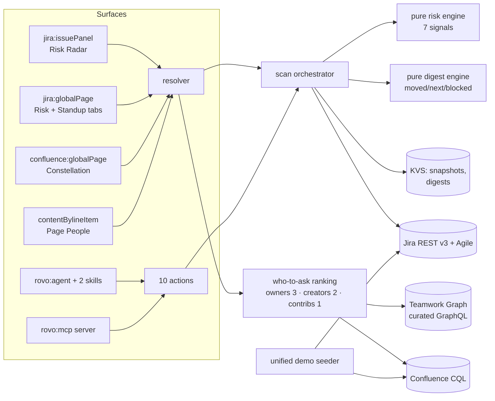

# 🔭 Atlassian Telemetry

**One app: the sprint risk radar, the standup digest, and the knowledge
constellation.** A Forge app for Codegeist 2026 that answers the three
questions every delivery team asks — *what's risky?, what moved?, who do I
ask?* — through one UI, one Rovo agent, and one MCP server.

> Teams lose sprints to invisible risk, waste standups on roll call, and ask
> the wrong person for knowledge. Telemetry makes all three visible.

## Judge quick path (fresh site, 60 seconds)

> **Install (approve ALL requested scopes — the Teamwork Graph ones are
> load-bearing) → Jira → Apps → Telemetry → "Generate demo content" → Scan now.**
> One click seeds BOTH a demo Jira sprint (10 issues tuned so every risk
> signal fires, including a real Blocks link and an ended sprint) AND a demo
> Confluence space (4 owner-tagged pages). Risk radar, digest and
> who-to-ask all have data within a minute. Nothing existing is touched.

## What it does

| Surface | Module | What the user gets |
|---|---|---|
| **Command Center** (Jira global page) | `jira:globalPage` | Two tabs: 🛡️ Risk (board scan, signal rollup, top risks, trend sparkline) and ☀️ Standup (per-person digest with since-hours window) |
| **Risk Radar panel** (issue view) | `jira:issuePanel` | Instant audit of the open issue: findings with evidence, one-click follow-up subtask |
| **Constellation** (Confluence global page) | `confluence:globalPage` | Your teams, members, linked spaces — live from the Teamwork Graph — plus "who to ask" ranked people |
| **Page People byline** | `confluence:contentBylineItem` | Creator, owners, recent contributors of any page |
| **Telemetry agent** | `rovo:agent` + 2 `rovo:skill`s | One agent over all three engines: 10 actions, chat starters for each |
| **MCP server** | `rovo:mcp` | All 10 tools for Rovo Studio custom agents and third-party MCP clients |
| **Continuous watch** | `scheduledTrigger` + `trigger` | Hourly risk snapshots (KVS trend) + digest caches |

## Why one app

Each engine is small and sharp alone; together they compound. The risk radar
knows *what* is dangerous, the digest knows *who* it lands on, and the
constellation knows *who to ask* about it. One agent can act across all
three ("what's risky, whose standup does it hit, and who should I ask about
that area?") because they share one action surface and one MCP server.

## Architecture



Every engine is pure and unit-tested (**40 tests** — CI badge above); all
I/O lives at the edges and degrades gracefully. The agent is read-only by
default; CREATE/UPDATE actions are gated behind explicit user confirmation
in the prompt and both skill playbooks.

## Risk signals (the radar's 7)

| Signal | Severity | Detection |
|---|---|---|
| `missing-acceptance-criteria` | high | No AC section / Given-When-Then / 3+ checklist (ADF-aware) |
| `unestimated-work` | medium | Story/bug with no estimate |
| `stale-in-progress` | medium | In Progress, no update ≥ 3 days |
| `overdue-sprint-item` | high | Sprint end passed, item not done |
| `review-load` | medium | Assignee has > 2 open PRs (Bitbucket dev-status) |
| `blocking-dependency` | high | Blocked-by link (either direction) to unresolved issue |
| `scope-churn` | low | Description edited > 3 times (changelog) |

## Quick start

```bash
npm install -g @forge/cli@latest
npm install
forge register        # first time only; put your app id in manifest.yml
forge deploy
forge install         # on your site, e.g. your-site.atlassian.net
```

Then open Jira → Apps → Telemetry. On an empty site, click **Generate demo
content** and everything populates.

## Testing

```bash
npm test              # 40 unit tests across all three engines
```

## License

Apache-2.0
